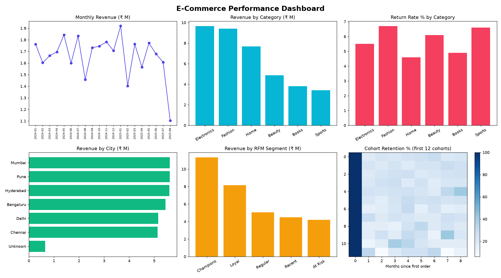

# 🛒 E-Commerce Sales & Customer Retention Analysis

An end-to-end data analytics project built with **Python, SQL (SQLite) and Power BI**. It cleans messy order data, analyses revenue and customer behaviour with SQL, and turns the results into a dashboard and business recommendations.

## 🎯 Problem Statement
An online retailer wants to know:
- Where is revenue coming from (category, city, time)?
- Which categories have high return rates?
- Why are new customers not coming back, and who is at risk of churning?

## 🛠️ Tech Stack
Python (pandas, NumPy, Matplotlib) · SQL (SQLite) · Power BI (DAX) · VS Code · Git

## 🔄 Workflow
1. **Data generation:** synthetic order data (about 6,000 rows) with deliberately injected duplicates, nulls, inconsistent casing and invalid values.
2. **Data cleaning (pandas):** duplicate removal, text standardisation, date parsing, invalid-quantity filtering, and median imputation of missing prices by category. Every fix is logged.
3. **SQL analysis:** monthly revenue, category performance and return rate, city revenue, cohort retention (CTEs), RFM segmentation and top customers.
4. **Visualisation:** 6-panel Python dashboard plus an interactive Power BI dashboard (DAX measures).
5. **Automation and reporting:** one script re-runs the full pipeline and generates `insights_report.md`.

## 📊 Key Insights
- Delivered revenue of about ₹33 M across 5,100+ orders.
- Electronics is the top revenue category. Fashion has the highest return rate.
- Mumbai is the top-revenue city.
- Month-1 customer retention is only about 25%.
- 283 customers fall in the "At Risk" RFM segment.

## 💡 Recommendations
- Run win-back campaigns for At Risk customers.
- Offer a second-order incentive within 30 days.
- Investigate quality and size issues in Fashion to cut returns.
- Increase inventory and marketing in top city and category.
- Launch a loyalty programme for Champions.

## 📁 Project Structure
```
├── analysis.py            # full pipeline (clean → SQL → charts → report)
├── raw_orders.csv         # messy input data
├── clean_orders.csv       # cleaned data (used in Power BI)
├── orders.db              # SQLite database
├── dashboard.png          # Python dashboard
├── insights_report.md     # auto-generated findings
└── ecommerce_dashboard.pbix   # Power BI dashboard (optional)
```

## ▶️ How to Run
```bash
git clone <your-repo-url>
cd ecommerce_analysis
python -m venv venv
venv\Scripts\activate        # Mac/Linux: source venv/bin/activate
pip install pandas numpy matplotlib
python analysis.py
```
For Power BI: Get Data → Text/CSV → `clean_orders.csv`, then add the DAX measures (Total Revenue, Total Orders, Avg Order Value, Return Rate %).

## 📸 Dashboard Preview


## 🔮 Future Improvements
- Use a real dataset (e.g. Olist or Superstore)
- Add a churn prediction model
- Schedule the pipeline with Airflow or cron
- Deploy an interactive dashboard with Streamlit

## 👤 Author
**Govardhana Ramgopal** · [LinkedIn](https://www.linkedin.com/in/govardhana-ramgopal-computer-engineering?utm_source=share_via&utm_content=profile&utm_medium=member_android) · [GitHub](https://github.com/Govardhana007)
